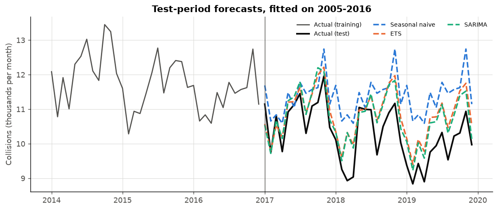

# UK Road Collision Analytics (STATS19, 2005-2019)

**Official DfT road-collision data for Great Britain, cleaned and reconciled with published totals, then used for effect-size statistics, a backtested monthly forecast, a leakage-free severity model, traffic-adjusted hotspots, and correct rebuilds of the original coursework's hotspot, clustering and anomaly analyses.**

Author: Maryam · Code: MIT · Data: Open Government Licence v3.0

---

## Key results

> Built from the DfT release downloaded on 2026-10-02 and again on 2026-10-03 (identical totals;
> 2005-2019 only), plus DfT road traffic counts downloaded on 2026-10-04. Every number below is copied from an executed notebook cell, as printed; the
> few shortened ones say how they were rounded. Plain accuracy is deliberately not reported.

**Severity model:** pre-event conditions carry limited signal (PR-AUC 0.28 vs 0.20 base rate,
rounded from 0.2798 and 0.1981); logistic regression performs almost as well as LightGBM.

**Forecasting:** on 2017-2019, SARIMA beats seasonal naive (MAE 529.39 vs 1,107.72). In the 2015
replica check ETS was the most accurate, and SARIMA's residuals still contain autocorrelation.

**Hotspots:** 1,002 hexagons are significant KSI hotspots (Gi\*, FDR 0.05), but they are mostly
busy places: 936 of them are in the busiest 10% of hexagons. Dividing by traffic (major roads,
DfT counts), only 216 of the 839 count hotspots on the same hexagons are also hot on KSI risk
per vehicle-km.

**Clusters and anomalies:** rural high-speed roads are the one collision context with a clearly
higher KSI share (0.2312 vs 0.1825). Collision-level anomalies are rare or badly recorded
combinations, not more severe collisions; anomalous *days* are snow and ice days.



*Test-period forecasts from notebook 03 (fitted on 2005-2016, scored on 2017-2019).*

| Track | Result | Source (notebook · section) |
|---|---|---|
| Data quality | All 15 years match RAS0101 exactly: collisions, fatal, fatal-or-serious (unadjusted and adjusted), people killed, casualties. Largest yearly difference **0.000%** (2,287,427 collisions in total) | 01 · Pipeline vs RAS0101 |
| Effect sizes | KSI × light / weather / road type: significant but **negligible** in size (Cramér's V 0.065 / 0.032 / 0.052) | 02 · Statistical tests |
| Count model | Poisson dispersion 7.86, so **Negative Binomial** (α 0.0181). 2019 vs 2005 daily-rate IRR 0.591 (95% CI 0.579-0.604) | 02 · Count model |
| Forecast, test 2017-2019 | **SARIMA(1,1,1)x(1,0,2,12): MAE 529.39, MAPE 5.26%**, vs seasonal naive MAE 1,107.72, MAPE 11.17% (ETS: 602.34, 6.01%) | 03 · Final test |
| Forecast, 2015 replica | Error vs official 2015 total (140,056): ETS +1.4%, SARIMA +2.4%, seasonal naive +4.5% | 03 · Replica check |
| Forecast, residuals | Ljung-Box p 0.000 (lag 12) and 0.002 (lag 24): some autocorrelation left unmodelled | 03 · Residual diagnostics |
| KSI model, test 2017-2019 | PR-AUC **LightGBM 0.2798**, logistic regression 0.2719, dummy / base rate 0.1981. Balanced accuracy LightGBM 0.5736, logistic 0.5712, dummy 0.5000 | 04 · Test results |
| KSI model, top 5 SHAP | Not at a junction (↑), daylight (↓), 60 mph limit (↑), roundabout (↓), rural (↑). Model behaviour, not causes | 04 · SHAP |
| KSI model, robustness | Against DfT-adjusted severity: LightGBM weighted PR-AUC 0.3163 vs adjusted base rate 0.2228 (logistic 0.3093) | 04 · Robustness check |
| Kaggle copy audit | 1,504,150 rows; **2008 has 0 rows**; 34,144 exact duplicate rows in 2012 (179,715 rows vs RAS0101 145,571, i.e. +23.46%; 145,571 after removing them); 569,359 index values (37.9%) in scientific notation; 101 rows with latitude 0 and no longitude | 00 · Side by side, sections 1-4 |
| KSI model, Random Forest | Test PR-AUC **0.2785** (LightGBM 0.2798, logistic 0.2719); balanced accuracy 0.5730; macro-F1 0.5125; trained on all 1,780,653 training rows | 04 · Random Forest |
| KSI model, bootstrap CIs | 1,000 paired bootstrap resamples of the test set: LightGBM 0.2798 (95% CI 0.2768-0.2828), RF 0.2785 (0.2755-0.2814), logistic 0.2719 (0.2691-0.2747). **LightGBM minus logistic +0.0079 (+0.0067 to +0.0092): excludes zero**, but small | 04 · Added evaluation 1 |
| KSI model, calibration | Class weighting inflates probabilities (mean predicted 0.4757-0.4811 vs observed 0.1981). Brier before / after isotonic fitted on 2016: logistic 0.2365 / 0.1561, LightGBM 0.2364 / 0.1557, RF 0.2331 / 0.1558; constant 2016 share 0.1596 | 04 · Added evaluation 2 |
| KSI model, subgroups | LightGBM PR-AUC vs base rate: urban 0.2216 vs 0.1757 (lift 1.26), rural 0.3376 vs 0.2443 (1.38); 30 mph 0.2225 vs 0.1801 (1.24), 60-70 mph 0.3595 vs 0.2602 (1.38). Weakest where most collisions are | 04 · Added evaluation 3 |
| Forecast, interval coverage | SARIMA 80% interval covers 35 of 36 test months (0.972), 95% interval 36 of 36 (1.000): intervals are **conservative**, not too narrow | 03 · Added evaluation |
| Hotspots (Gi\*) | H3 res 7, k = 6, 999 permutations, BH FDR 0.05: **1,002 hot, 0 cold** of 28,801 hexagons (3.5% of hexagons, 32.1% of KSI collisions); Greater London at res 8: 180 hot | 05 · Gi\* |
| Hotspots, KSI rate | 277 of 4,287 hexagons (≥ 30 collisions) have a Wilson lower bound above the overall KSI share 0.1826; none of the top 15 is a count hotspot. Stability 2015-2016 vs 2018-2019: Jaccard 0.603 | 05 · KSI rate, Stability |
| Hotspots, exposure | KSI vs all collisions per hexagon: Spearman 0.825; KSI share inside hot hexagons 0.1472 vs 0.2059 elsewhere; Gi\* on KSI share: 50 hot, of which 8 are count hotspots (Jaccard 0.008). k = 12 vs k = 6: Jaccard 0.618 | 05 · Added evaluation |
| Clusters (k-modes) | k = 5 (most stable, mean ARI 0.294; low for every k). Rural high-speed roads: KSI share **0.2312** (95% CI 0.2264-0.2361) vs 0.1825; highest-KSI cluster is 97-100% rural in all 5 seeds. Label-encoded K-Means silhouette 0.330 is an artefact (ARI 0.407 after reassigning codes) | 06 |
| Traffic exposure (major roads) | 276,079 of 312,386 major-road collisions (88.4%) matched to the nearest same-road DfT count point within 2 km (median 460 m; 97.6% within 5 km). **2.76 KSI per 100 million vehicle-km** overall: motorways 0.51, trunk A roads 1.42, principal A roads 4.85 | 08 · Sections 2-3 |
| Risk per vehicle-km, links | Empirical Bayes (Poisson-gamma, within road group), links with ≥ 20M vehicle-km: top 20 by KSI count and top 20 by EB rate share 8 links (Jaccard 0.250); all 40 are principal A roads | 08 · Section 3 |
| Traffic-adjusted hotspots | Gi\* on EB KSI rate per vehicle-km: **255 hot, 0 cold** of 7,889 hexagons. Of 839 count hotspots on the same hexagons, **216 are also rate-hot** (Jaccard 0.246); London keeps 61.3% of its count hotspots, the North West 8.9%, the West Midlands 9.1%. Sensitivity Jaccard: 5 km cap 0.818, exposure minimum halved 0.832, doubled 0.773 | 08 · Section 4 |
| KSI model, gains | Top decile of LightGBM predicted risk holds 17.4% of test KSI collisions (lift 1.74); top 30% hold 41.7% | 04 · Cumulative gains |
| Anomalies | At contamination 0.02: Isolation Forest / autoencoder overlap 198 rows (Jaccard 0.113), LOF 0 and 2. KSI enrichment IF 1.17 (1.03-1.31), LOF 1.11 (0.97-1.26), autoencoder 0.70 (0.59-0.80). All 10 top anomalous days are snow or ice days | 07 |

## Original vs rebuilt

The left column is the **original coursework output**, quoted as recorded from the two original
projects (which are not part of this repository). The right column comes from the executed
notebooks here.

| Original coursework claim (original coursework output) | Rebuilt result |
|---|---|
| 1.5M records ("1.8M, 2000-2018" on slides); data 2005-2014 with 2008 missing and 34,144 duplicate 2012 rows | Official data, 2,287,427 collisions 2005-2019, exact match with DfT totals (notebook 01). The Kaggle copy itself: 1,504,150 rows, 2008 = 0 rows, 34,144 exact duplicate 2012 rows (notebook 00) |
| RF accuracy 0.8429 vs majority baseline 0.8511; fatal recall 0.034 | Test 2017-2019 PR-AUC with 95% bootstrap CIs: RF 0.2785 (0.2755-0.2814), LightGBM 0.2798 (0.2768-0.2828), logistic 0.2719 (0.2691-0.2747), base rate 0.1981. Balanced accuracy RF 0.5730, LightGBM 0.5736, logistic 0.5712. Pre-event features only, year split asserted disjoint, threshold chosen on 2016 (notebook 04) |
| IF and autoencoder "consistently identified" anomalies (agreement bug; true overlap ~218 of 30,083) | At contamination 0.02 on 50,000 held-out collisions, IF and autoencoder share 198 flagged rows (Jaccard 0.113); LOF shares 0 and 2. KSI enrichment: IF 1.17 (95% CI 1.03-1.31), autoencoder 0.70 (0.59-0.80), LOF 1.11 (0.97-1.26) (notebook 07) |
| K-Means "hotspots" | 1,002 Gi\* hot hexagons and 0 cold (H3 res 7, BH FDR 0.05). Exposure check: 936 of them are in the busiest 10% of hexagons, and only 8 of 967 are also hot on KSI share (notebook 05) |
| K-Means on label-encoded features, silhouette 0.36-0.43 | k-modes, k = 5 (mean ARI 0.294 across seeds). Rural high-speed roads: KSI share 0.2312 (0.2264-0.2361) vs 0.1825 overall. On the same sample, label-encoded K-Means silhouette 0.330 is an artefact (ARI 0.407 after reassigning codes); one-hot K-Means 0.108, k-modes 0.109 (notebook 06) |
| SARIMA never validated; 2015 total off by +3.4% | Rolling-origin backtest MAE 474.34 vs seasonal naive 600.88; test 2017-2019 MAE 529.39 (MAPE 5.26%) vs 1,107.72; 2015 replica +2.4% (ETS +1.4%); interval coverage 0.972 (80%) and 1.000 (95%) (notebook 03) |
| Dashboard YoY about -89% | Corrected DAX in [`dashboard/measures.md`](dashboard/measures.md): `SAMEPERIODLASTYEAR` on a marked Date table, so the previous year is exactly one year back, and `DIVIDE` blanks the first year. The rebuilt dashboard screenshot is still TBD |

## Dashboard

*Dashboard screenshot: TBD. Save it as `dashboard/screenshots/overview.png` and embed it here, after the Power BI report is built from `dashboard/data/` using
[`dashboard/measures.md`](dashboard/measures.md).*

## Data and licence

- **Source:** Department for Transport, [Road Safety Data (STATS19)](https://www.gov.uk/government/statistical-data-sets/road-safety-open-data):
  the collision and casualty tables (1979 to latest year), filtered to **2005-2019**.
  2020 onwards is excluded from modelling, because COVID-19 travel changes and further
  reporting changes break comparability.
- **Official totals:** table [RAS0101](https://www.gov.uk/government/statistical-data-sets/reported-road-accidents-vehicles-and-casualties-tables-for-great-britain),
  used for reconciliation.
- **Code lists:** the DfT Road Safety Open Dataset data guide (`.xlsx`), used to decode every coded field.
- **Traffic counts (notebook 08):** DfT [road traffic statistics](https://roadtraffic.dft.gov.uk/downloads),
  annual average daily flow (AADF) by count point (`dft_traffic_counts_aadf.zip`) and its
  metadata, OGL v3.0.
- No data is committed. `data/raw/` and `data/processed/` are gitignored.
- Attribution: *Contains public sector information licensed under the Open Government Licence v3.0. Source: Department for Transport, Road Safety Data (STATS19) and Road traffic statistics.*
  See [DATA_LICENSE.md](DATA_LICENSE.md).

## How to run

### Local (Python 3.11)

```bash
git clone https://github.com/maryam843/uk-road-accident-analytics.git
cd uk-road-accident-analytics
python -m venv .venv && source .venv/bin/activate
pip install -r requirements.txt
nbstripout --install --attributes .gitattributes   # keeps notebook diffs clean

python -m src.download    # several GB into data/raw/ (resumable), logs to DOWNLOAD_LOG.json
python -m src.clean       # chunked cleaning -> data/processed/*.parquet + dashboard/data/*.csv
jupyter lab notebooks/    # run 01 -> 08 in order (00 needs the Kaggle CSV, see below)
python -m src.dashboard_exports   # extra dashboard CSVs (after notebooks 00, 03 and 07 have run)

pytest -q && ruff check .
```

Set `DATA_DIR=/some/path` to keep the data outside the repo. Notebooks 00-08 have
`keep_output` set in their metadata, so their executed outputs survive the nbstripout filter
when committed. Notebook 00 audits a third-party Kaggle copy of the data; it is not downloaded
by the pipeline. Put it at `DATA_DIR/kaggle/ukroadaccident.csv` by hand to rerun 00 (every cell
skips with a message if it is absent), and delete it afterwards. Notebook 07 trains a small
TensorFlow model on CPU; 04 is the longest run (runtimes and peak memory are logged in
`PROGRESS.md`).

### Google Colab (free tier)

Click a badge and run all cells. The badges point at the `main` branch. The first cell clones the repo and installs
`requirements.txt`; restart the runtime once if Colab asks. The second cell downloads and
cleans the data if `data/processed/` is empty. The CSVs are read in 500k-row chunks and
stored as Parquet, so the large collision file is never loaded into memory at once. To keep the data between sessions, mount Drive and set `os.environ["DATA_DIR"]` to a Drive
folder before the setup cell.

| Notebook | Open |
|---|---|
| 00 Kaggle data audit | [](https://colab.research.google.com/github/maryam843/uk-road-accident-analytics/blob/main/notebooks/00_kaggle_data_audit.ipynb) |
| 01 Reconciliation with RAS0101 | [](https://colab.research.google.com/github/maryam843/uk-road-accident-analytics/blob/main/notebooks/01_reconciliation.ipynb) |
| 02 EDA and statistical tests | [](https://colab.research.google.com/github/maryam843/uk-road-accident-analytics/blob/main/notebooks/02_eda_and_tests.ipynb) |
| 03 Forecasting | [](https://colab.research.google.com/github/maryam843/uk-road-accident-analytics/blob/main/notebooks/03_forecasting.ipynb) |
| 04 Severity model | [](https://colab.research.google.com/github/maryam843/uk-road-accident-analytics/blob/main/notebooks/04_severity_model.ipynb) |
| 05 Spatial hotspots | [](https://colab.research.google.com/github/maryam843/uk-road-accident-analytics/blob/main/notebooks/05_spatial_hotspots.ipynb) |
| 06 Clustering | [](https://colab.research.google.com/github/maryam843/uk-road-accident-analytics/blob/main/notebooks/06_clustering.ipynb) |
| 07 Anomalies | [](https://colab.research.google.com/github/maryam843/uk-road-accident-analytics/blob/main/notebooks/07_anomalies.ipynb) |
| 08 Traffic-adjusted hotspots | [](https://colab.research.google.com/github/maryam843/uk-road-accident-analytics/blob/main/notebooks/08_traffic_adjusted_hotspots.ipynb) |

Example Colab cell to run the whole pipeline without a notebook:

```python
!git clone -q https://github.com/maryam843/uk-road-accident-analytics.git
%cd uk-road-accident-analytics
%pip install -q -r requirements.txt
!python -m src.download && python -m src.clean
```

## Project structure

```
├── src/
│   ├── config.py        paths (DATA_DIR), URLs, study window, split years, random_state=42
│   ├── download.py      streaming download with resume, size check, SHA-256, download log
│   ├── clean.py         chunked cleaning, code decoding, aggregates, dashboard CSVs, RAS0101 reader
│   ├── features.py      pre-event features, year splits, ColumnTransformer, categorical contexts
│   ├── evaluate.py      metrics, effect sizes, backtest, Wilson/bootstrap/Jaccard helpers, plot style
│   ├── spatial.py       H3 aggregation, k-nearest-neighbour weights, Gi* with FDR control
│   ├── traffic.py       DfT AADF traffic counts: loading, vehicle-km, same-road collision matching
│   └── dashboard_exports.py  extra dashboard CSVs built from the pipeline and executed notebooks
├── notebooks/
│   ├── 00_kaggle_data_audit.ipynb   why the old Kaggle copy was rejected
│   ├── 01_reconciliation.ipynb      pipeline vs official RAS0101 totals
│   ├── 02_eda_and_tests.ipynb       EDA, effect sizes, Poisson / Negative Binomial count model
│   ├── 03_forecasting.ipynb         seasonal naive vs ETS vs SARIMA, rolling-origin backtest
│   ├── 04_severity_model.ipynb      KSI classifier (logistic, LightGBM, RF), SHAP, CIs, calibration
│   ├── 05_spatial_hotspots.ipynb    H3 + Gi* hotspots, Wilson KSI rates, exposure check
│   ├── 06_clustering.ipynb          k-modes collision contexts vs label-encoded K-Means
│   ├── 07_anomalies.ipynb           Isolation Forest, autoencoder, LOF, anomalous days
│   └── 08_traffic_adjusted_hotspots.ipynb  KSI risk per vehicle-km on major roads, EB, Gi*
├── tests/               pytest suite + synthetic fixture generator (tests/fixtures/)
├── dashboard/           measures.md (DAX + build guide), data/ (aggregated CSVs), screenshots/
├── reports/             hotspot_map.html, traffic_adjusted_map.html (folium), figures/
├── docs/INTERVIEW_NOTES.md   every key decision, explained
└── data/                gitignored: raw/, processed/, kaggle/
```

## Methods

**Data pipeline.** The CSV header is read first and column names are normalised to
`collision_*`. The file is then read in 500k-row chunks and filtered to 2005-2019. Duplicate
collision indexes are dropped and counted. `-1`, "data missing or out of range" and
"unknown (self reported)" become NaN, never a category. Speed limits other than
20/30/40/50/60/70 are set to NaN. Bad coordinates are flagged, never imputed. Only casualties
whose collision survived cleaning are kept. Every step's count goes to `CLEAN_LOG.json`.

**Reconciliation.** Yearly collisions, fatal collisions, fatal-or-serious collisions
(unadjusted and adjusted), people killed and all casualties are compared with RAS0101. The
notebook asserts that collision counts match within 0.5% every year.

**Statistics.** Chi-square with Cramér's V, Welch t with Cohen's d, and ANOVA with
eta-squared. Effect sizes are interpreted rather than p-values, because n is in the millions.
Daily counts are modelled with a Poisson GLM (year + month + weekday as categorical). It
switches to Negative Binomial when Pearson χ²/df > 1.5. Results are incidence rate ratios
with 95% CIs.

**Forecasting.** Monthly collisions, trained on 2005-2016 and tested on 2017-2019.
Seasonal naive is the baseline, compared with ETS and with SARIMA (order chosen once by
`auto_arima` on the training data, then fixed). Rolling-origin backtest from 2012-12 every 12
months, horizon 12. A replica check forecasts the 2015 total from data to 2014. Ljung-Box and
ACF residual checks.

**Severity model.** Binary KSI vs slight at collision level, using pre-event features only.
Police attendance, casualty counts and every casualty field are excluded as leakage. Year
splits: train 2005-2015, validate 2016, test 2017-2019, asserted disjoint by collision index.
Models: dummy baselines, class-balanced logistic regression, and LightGBM with class
weighting, early stopping and a 25-configuration random search on 2016. Reported: PR-AUC,
ROC-AUC, balanced accuracy, macro-F1 and KSI recall/precision at a 2016-chosen threshold,
overall and per test year. SHAP explains the model; it does not establish causes. A Random Forest (the original
project's model) is evaluated in exactly the same way. Added checks: paired bootstrap CIs for
test PR-AUC (1,000 resamples), reliability curves and Brier scores with isotonic calibration
fitted on 2016 only, and PR-AUC by urban/rural and speed-limit band.

**Spatial hotspots.** Collisions 2015-2019 with valid coordinates, counted per H3 hexagon
(res 7 for Great Britain, res 8 for Greater London). Getis-Ord Gi\* on KSI counts with 6
nearest-neighbour weights and 999 permutations; two-sided p-values from the permutation z-score,
Benjamini-Hochberg FDR at 0.05. Only significant positive cells are called hotspots. KSI rates
per hexagon (≥ 30 collisions) carry Wilson 95% intervals. Checks: stability across periods,
Gi\* on KSI share (exposure), and k = 12 neighbours.

**Clustering.** k-modes (Huang initialisation) on nine categorical context features of a
stratified 100,000-collision sample; k chosen from the cost elbow and the adjusted Rand index
between five seeds; clusters profiled with Wilson intervals for KSI share. The outcome is never
a clustering input.

**Traffic-adjusted hotspots.** DfT annual average daily flow (AADF) by count point, 2015-2019;
vehicle-km per link = AADF x link length x 365, available for major roads only. Each major-road
collision (motorway, A(M), A) is matched to the nearest count point on the same road with an
AADF in the same year, within 2 km (5 km as a check), using British National Grid metres. Link
KSI rates per 100 million vehicle-km carry exact Poisson intervals and are shrunk by empirical
Bayes (Poisson-gamma, method of moments within road group). Links and their exposure are then
placed in the H3 res-7 hexagon of their count point, and Gi\* (k = 6, 999 permutations, BH FDR
0.05) runs on the hexagon EB rate for hexagons with at least 20 million vehicle-km.

**Anomaly detection.** One-hot categorical plus standardised numeric features; encoder, scaler,
PCA (95% variance), Isolation Forest and a dense autoencoder fitted on 150,000 collisions; all
detectors (and LOF) evaluated on the same 50,000 held-out collisions after converting their
outputs to explicit {0, 1} flags. Evaluation without labels: overlap, Spearman correlation of
scores, KSI enrichment with bootstrap CIs, profiles of flagged rows. A daily-profile variant
scores days instead of collisions.

## Limitations

- **Injury collisions only.** STATS19 covers collisions reported to the police in which
  someone was injured. Damage-only collisions are not included.
- **Under-reporting.** Many slight injuries never reach the police, so slight counts (and the
  denominator of every KSI share) are undercounts. Serious injuries are under-reported too,
  to a lesser degree.
- **Severity reporting change (label shift).** From 2016, injury-based reporting (CRASH/COPA)
  records more injuries as serious. The reported KSI share rises from 0.141 (2005) to 0.210
  (2019), while the DfT-adjusted share moves from 0.198 to 0.230. KSI trend charts use DfT's
  adjusted figures and are labelled "adjusted for changes in police severity reporting (DfT)".
  The classifier is trained on 2005-2015 labels and tested on 2017-2019 labels, so metrics are
  shown per year.
- **Result of the label-shift check.** Rescored against DfT-adjusted severity, without
  retraining, LightGBM's weighted PR-AUC is 0.3163 against an adjusted base rate of 0.2228
  (reported-label: 0.2798 vs 0.1981). The reporting change moves the level of the scores. It
  does not create or remove the model's limited signal.
- **Limited predictive signal.** Pre-event conditions only modestly separate KSI from slight
  collisions (PR-AUC 0.2798 vs a 0.1981 base rate). The model ranks risk; it cannot predict
  outcomes for individual collisions.
- **Forecast residuals.** The SARIMA residuals fail the Ljung-Box test (p 0.000 at lag 12). On
  2017-2019 its prediction intervals nevertheless over-cover (80% interval: 0.972; 95%: 1.000),
  so they are conservative rather than too narrow; 36 months is a small check.
- **SHAP is descriptive.** It explains what the model learned from correlations, not causes.
- **Exposure is only partly modelled.** Notebooks 02-07 use counts, and more collisions can
  simply mean more traffic: 936 of the 1,002 count hotspots in notebook 05 are among the
  busiest 10% of hexagons, and their KSI share (0.1472) is below that elsewhere (0.2059).
  Notebook 08 adds exposure (vehicle-km) for major roads only, which is the only place risk
  per vehicle-km is computed.
- **Traffic scope (notebook 08).** Link lengths, and so vehicle-km, exist only for motorways
  and A roads, so 312,386 of 646,830 collisions in 2015-2019 are in scope. One count point's
  AADF stands for a whole link and 77.7% of major-road AADFs are estimated rather than counted.
  Junction collisions can match the crossing road; unmatched collisions are more severe (KSI
  share 0.2437 vs 0.1727). Vehicle-km counts motor traffic only, not pedestrians or cyclists.
- **Clusters are not stable groups.** Mean adjusted Rand index between seeds is at most 0.294,
  so the k-modes clusters are a summary; only the high-KSI rural cluster is robust to the seed.
- **Anomaly detection has no ground truth.** It is evaluated indirectly (KSI enrichment,
  profiles, overlap), and LOF is unreliable on data where 74.0% of rows have exact duplicates.
- **2020 onwards is excluded.**
- **Approximate regions.** Region comes from police force area, which does not match ONS
  regions exactly.

## Origins

Rebuilt and extended solo from two university projects: a solo data analysis and forecasting project and a two-person data mining project (teammate acknowledged with consent). All code in this repository is my own re-implementation.
