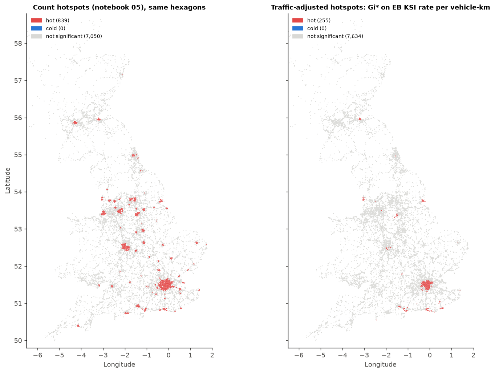
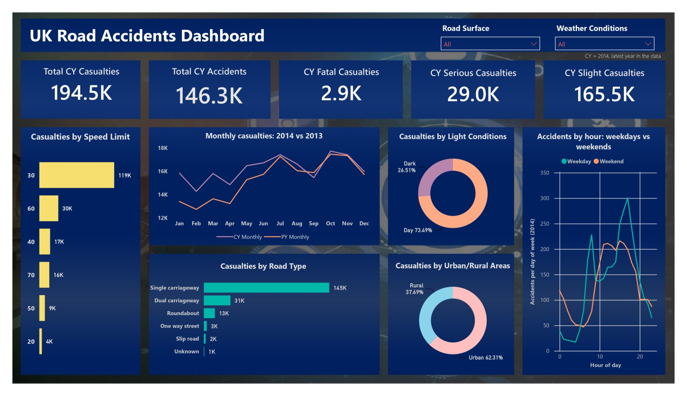

# UK Road Collision Analytics
[](https://github.com/maryam843/uk-road-accident-analytics/actions/workflows/ci.yml)

Analysis of 2,287,427 police-reported injury road collisions in Great Britain (2005 to 2019) on official Department for Transport data: totals reconciled exactly with the published figures, hotspots re-ranked by risk per vehicle-km, and a severity model scored against honest baselines.

## Key results

- **Data matches the official totals:** 0.000% difference from table RAS0101 for all 8 measures in all 15 years (collisions, fatal, killed or seriously injured (KSI) unadjusted and adjusted, people killed, casualties).
- **Count hotspots are not the same as risk hotspots:** counting the same matched major-road KSI collisions in both maps, 174 of 273 count hotspots stay high-risk per vehicle-km, 99 do not, and 81 risk hotspots are missed by a count map (Jaccard 0.492). Major roads only.
- **Severity is only weakly predictable from pre-crash conditions:** test PR-AUC 0.2798 (LightGBM) against a base rate of 0.1981. The 10% of test collisions with the highest predicted risk hold 17.4% of KSI collisions.
- **A simple baseline wins the forecast test:** a trend x seasonal profile baseline has the lowest 2017 to 2019 monthly MAE (482.14). SARIMA (529.39) beats seasonal naive (1,107.72) but not that baseline.

## Visual



*Left: Gi\* hotspots of all-road KSI collision counts (839 on the 7,889 hexagons with traffic data). Right: Gi\* hotspots of empirical Bayes KSI rate per vehicle-km (255). This figure uses all-road counts; the like-for-like comparison above (174 of 273) is printed in notebook 08. Interactive versions: [`reports/hotspot_map.html`](reports/hotspot_map.html) and [`reports/traffic_adjusted_map.html`](reports/traffic_adjusted_map.html) (download and open in a browser).*



An earlier Power BI dashboard built on the Kaggle copy of the data (2005 to 2014); see [dashboard/earlier_version/README.md](dashboard/earlier_version/README.md). PDF: [UK_Road_Accidents_Dashboard.pdf](dashboard/earlier_version/UK_Road_Accidents_Dashboard.pdf). It shows 2013 and 2014 only, which the gaps found in notebook 00 (no 2008 rows, duplicated 2012 rows) do not affect; its 2014 casualty total matches the DfT figure.

**Tools:** Python, pandas, statsmodels, scikit-learn, LightGBM, SHAP, H3, PySAL (esda), folium, pytest, GitHub Actions, Power BI

## Data

- **Source:** Department for Transport, [Road Safety Data (STATS19)](https://www.gov.uk/government/statistical-data-sets/road-safety-open-data), collision and casualty tables, filtered to 2005 to 2019. Official totals from table [RAS0101](https://www.gov.uk/government/statistical-data-sets/reported-road-accidents-vehicles-and-casualties-tables-for-great-britain). Traffic counts (annual average daily flow by count point) from [DfT road traffic statistics](https://roadtraffic.dft.gov.uk/downloads).
- **Size:** 9,116,625 collision rows read (1979 to latest), 2,287,427 collisions and 3,069,041 casualties kept. The collision and casualty CSVs are 1.53 GB and 0.99 GB.
- **Licence:** Open Government Licence v3.0. Attribution and links in [DATA_LICENSE.md](DATA_LICENSE.md).
- **Not in the repo:** the files are large and are published by DfT, so `python -m src.download` fetches them at run time (resumable, with a size check and a SHA-256 log). Only small aggregated CSVs are committed. See [data/README.md](data/README.md).
- **Kaggle copy:** notebook 00 audits a widely shared Kaggle copy of the same data and shows why it is not used (2008 has 0 rows, 34,144 duplicated 2012 rows, 37.9% of ids in scientific notation). That file is supplied by hand and is not downloaded by the pipeline.

## Approach

1. **Clean:** read the CSVs in 500,000-row chunks, normalise old and new column names, turn missing codes into missing values, decode every coded field with the DfT data guide, and flag (never impute) bad coordinates.
2. **Reconcile:** compare 8 yearly measures with RAS0101 before any analysis, so every later number rests on data that matches the official totals.
3. **Statistics:** report effect sizes rather than p-values (n is in the millions), and model daily counts with a Negative Binomial GLM because the Poisson model was overdispersed (dispersion 7.86).
4. **Forecast:** SARIMA and ETS against two baselines (seasonal naive and a trend x seasonal profile), with a rolling-origin backtest, one held-out test on 2017 to 2019, and an interval coverage check.
5. **Severity model:** pre-crash features only, a year split (train 2005 to 2015, tune on 2016, test on 2017 to 2019) asserted disjoint, PR-AUC against the base rate, bootstrap intervals, calibration, subgroups and SHAP.
6. **Hotspots:** H3 hexagons, Getis-Ord Gi\* with 999 permutations and Benjamini-Hochberg FDR at 0.05. 936 of the 1,002 count hotspots sit in the busiest 10% of hexagons, so counts mostly follow traffic.
7. **Risk per vehicle-km:** match major-road collisions to the nearest same-road traffic count point (276,079 of 312,386 within 2 km), compute KSI per 100 million vehicle-km with empirical Bayes shrinkage, and run Gi\* again on the rate.
8. **Clusters and anomalies:** k-modes on collision contexts with a seed-stability check, and three anomaly detectors judged by KSI enrichment (no labels used as inputs).

## Results

Test period 2017 to 2019. Severity: 370,153 collisions. Forecast: 36 months.

| Task | Model | Metric | Test result |
|---|---|---|---|
| Severity (KSI) | LightGBM (tuned) | PR-AUC | **0.2798** (95% CI 0.2768 to 0.2828) |
| Severity (KSI) | Random Forest | PR-AUC | 0.2785 |
| Severity (KSI) | Logistic regression | PR-AUC | 0.2719 |
| Severity (KSI) | Baseline: dummy (base rate) | PR-AUC | 0.1981 |
| Monthly collisions | Baseline: trend x seasonal profile | MAE | **482.14** |
| Monthly collisions | SARIMA(1,1,1)x(1,0,2,12) | MAE | 529.39 |
| Monthly collisions | ETS | MAE | 602.34 |
| Monthly collisions | Baseline: seasonal naive | MAE | 1,107.72 |

LightGBM beats logistic regression by +0.0079 PR-AUC (paired bootstrap CI +0.0067 to +0.0092): detectable, but small. In the 2013 to 2016 backtest SARIMA has the lowest MAE (474.34) and the trend baseline the highest (998.84), so no forecast model wins everywhere. On major roads the overall rate is 2.76 KSI collisions per 100 million vehicle-km (motorways 0.51, trunk A roads 1.42, principal A roads 4.85).

## Limitations

- **Injury collisions reported to police only, with a label shift:** from about 2016 many forces moved to injury-based severity reporting, so the KSI share rises partly because the definition changed, and the test labels differ from the training labels.
- **Weak severity signal:** the model is a ranking aid, not a predictor of individual outcomes, and it is weakest on urban 30 mph roads where most collisions happen.
- **Risk per vehicle-km covers major roads only:** 312,386 of 646,830 collisions in 2015 to 2019 are in scope, and 77.7% of major-road traffic flows are DfT estimates rather than counts.
- **No dashboard on the current data:** `dashboard/data/` holds 15 aggregated CSVs and [`dashboard/measures.md`](dashboard/measures.md) the DAX measures, but the Power BI report for 2005 to 2019 is not built. The k-modes clusters are also unstable across seeds (mean ARI 0.294).

## How to run

Python 3.11. The full run needs about 2.6 GB of disk for data, at least 4.5 GB of RAM (notebook 04 peaks at 4.14 GiB) and about 35 minutes on 4 CPU cores. No GPU.

```bash
git clone https://github.com/maryam843/uk-road-accident-analytics.git
cd uk-road-accident-analytics
python3.11 -m venv .venv && source .venv/bin/activate
pip install -r requirements.txt jupyter==1.1.1
```

Tests and lint (the same as CI, on synthetic fixtures, no data needed):

```bash
ruff check . && pytest -q
```

Full pipeline (`DATA_DIR` is optional; the default is `data/` in the repo):

```bash
export DATA_DIR=/path/to/data
python -m src.download
python -m src.clean
for nb in notebooks/0[1-8]_*.ipynb; do
  jupyter nbconvert --to notebook --execute --ExecutePreprocessor.timeout=3600 --output-dir out "$nb"
done
python -m src.dashboard_exports
```

Notebook 00 needs the Kaggle CSV at `DATA_DIR/kaggle/ukroadaccident.csv`, supplied by hand; without it, its cells skip with a message. `src.dashboard_exports` reads result files that notebooks 00, 03 and 07 write to `reports/results/`.

## Repo structure

```text
uk-road-accident-analytics/
├── .github/workflows/ci.yml   install, ruff check, pytest on Python 3.11
├── src/                       download, clean, features, evaluate, spatial, traffic, dashboard exports
├── notebooks/                 00 to 08, executed with outputs saved
├── tests/                     pytest suite on synthetic fixtures (tests/fixtures/)
├── reports/figures/           PNG figures from the notebooks
├── reports/results/           small result files read by src/dashboard_exports.py
├── reports/*.html             2 interactive folium maps
├── dashboard/data/            aggregated CSVs and data dictionary for Power BI
├── dashboard/measures.md      DAX measures and build guide
├── dashboard/earlier_version/ earlier Power BI dashboard (PDF and image)
├── data/README.md             where raw and processed data go (nothing committed)
├── DATA_LICENSE.md            OGL v3.0 attribution for the DfT data
└── LICENSE                    MIT licence for the code
```

## Licence and credits

- Code: MIT licence, see [LICENSE](LICENSE).
- Data: Contains public sector information licensed under the Open Government Licence v3.0. Source: Department for Transport, Road Safety Data (STATS19) and Road traffic statistics. See [DATA_LICENSE.md](DATA_LICENSE.md).
- Map tiles in the HTML maps: © OpenStreetMap contributors.
